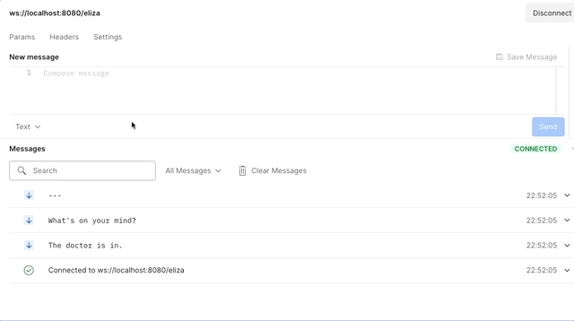

Fourth lab of 2026--2027. Command line is enough; **VS Code**, **IntelliJ IDEA**, **Eclipse**, or **GitHub Codespaces** are fine. You need **Java 25 LTS** (same pin as the group project).

**Estimated time**: 2 hours.

## Requirements

- [Kotlin 2.4.0](https://kotlinlang.org/) on **Java 25 LTS**. Do not downgrade the toolchain.
- [Gradle 9.6.0](https://gradle.org/) via the wrapper (`./gradlew`).
- [Spring Boot 4.1.0](https://docs.spring.io/spring-boot/) (Spring Framework 7) with `spring-boot-starter-websocket`. Tests use `spring-boot-starter-websocket-test`.
- [Ktlint](https://pinterest.github.io/ktlint/) on the build.

## Git and clone

1. Install [git](https://git-scm.com/).
2. GitHub education account: real name, university email.
3. Configure Git:

   ```bash
   git config --global user.name "Your Real Name"
   git config --global user.email "your_nip@unizar.es"
   ```

4. Authenticate with GitHub so you can clone this starter if Git asks. HTTPS is enough: [`gh auth login`](https://docs.github.com/en/github-cli/github-cli/quickstart) or Git Credential Manager. Do not use an account password. [Set up Git](https://docs.github.com/en/get-started/git-basics/set-up-git).

```bash
git clone \
  https://github.com/UNIZAR-30246-WebEngineering/lab4-websocket.git
cd lab4-websocket
./gradlew check
./gradlew bootRun
```

`./gradlew check` **passes** on the starter. `onChat` is disabled, so that green run is not your submission. After you remove `@Disabled`, the test fails until you finish it. With `./gradlew bootRun`, the endpoint is `ws://localhost:8080/eliza`.

### Codespaces (optional)

You can do the lab in [GitHub Codespaces](https://docs.github.com/en/codespaces) instead of a local JDK. Forward port **8080** when you `./gradlew bootRun`.

You cannot push to the course repository. If you need a remote of your own (Codespaces persistence), **fork** first and open the Codespace from that fork. A fork is not a submission: delivery is the Moodle zip only.

## Objective

Connecting already makes the doctor greet you. That greeting is tested. Do not test the greeting again.

You test one reply. Send one sentence to the doctor, and check that the answer is always the sentence you expect. In **REPORT.md**, explain why you have chosen that sentence and that answer and why no other sentence would have worked.

### Oral defence (all students)

An oral defence is **possible for everyone**, not only for the bonus. The teacher may ask you to explain this lab in person.

You are expected to **know** the submission and to **justify all decisions** in it: what you specified, what you changed, what you rejected, how you verified it, and any AI use. If you cannot explain a choice, you do not own it.

## What the server already does

On connect, `ElizaEndpoint` sends three texts:

1. `The doctor is in.`
2. `What's on your mind?`
3. `---`

After a chat line, the next text is the DOCTOR reply, then another `---`. `bye` closes the session.

The client in the test is a Jakarta WebSocket `@ClientEndpoint`. Messages arrive on another thread. `CountDownLatch` is how `onOpen` waits for them.

## Historical background

The app implements the DOCTOR script of [ELIZA](https://en.wikipedia.org/wiki/ELIZA), an early NLP program by [Joseph Weizenbaum](https://en.wikipedia.org/wiki/Joseph_Weizenbaum). The DOCTOR script simulates a [Rogerian psychotherapist](https://en.wikipedia.org/wiki/Person-centered_therapy).

You can talk to it with a WebSocket client (Postman, for example) at `ws://localhost:8080/eliza`:

::: {.content-visible when-format=html}

:::

::: {.content-visible when-format=pdf}

:::

Image created by Jorge Laguna (2021).

## Primary task

Complete the numbered comments in `src/test/kotlin/websockets/ElizaServerTest.kt`.

1. Remove `@Disabled` from `onChat`.
2. Follow comments 1--4 in `onChat`.
3. Follow comments 5--6 in `ComplexClient.onMessage`.

Do not change `Eliza` or `ElizaEndpoint` to make the test pass.

```bash
./gradlew test
```

### Manual verification

1. Connecting to `ws://localhost:8080/eliza` sends the three-line welcome, ending in `---`.
2. Sending a line receives a DOCTOR-style reply and another `---`.
3. Sending `bye` closes the session.

### Code quality

[Ktlint](https://pinterest.github.io/ktlint/) is on the build. Format before you submit:

```bash
./gradlew ktlintFormat
./gradlew ktlintCheck
```

### What to document

English, at least B1. Answer the report question in the objective. Commands in the report must actually work.

### Bonus

The bonus is optional. The bonus is **+0.05** on factor **k** (labs; cap **+0.10** across the six labs).

It is not extra work you add at submit time. Sequence:

1. The **student proposes** the extra (what you will do, why it is outstanding, how git history will stay readable). Propose during the lab window, **before** you treat that extra as bonus work.
2. The **instructor accepts** — or refuses if the proposal is too large, off-scope, or late.
3. **Only then** may that extra be done as bonus work.

Examples you may propose: a STOMP endpoint and a small client; a SockJS fallback that uses polling when WebSocket is unavailable; the server as a broker, with DOCTOR moved to a client.

After acceptance implement what was agreed, with tests and documentation another student could follow, then defend it in person.

Git is **mandatory** for the bonus: imperative commit subjects, small logical commits, feature branches, no dump-everything commits. `git rebase -i` is allowed to tidy *your* unpublished history; do not rewrite commits already in a zip you submitted.

Those commits must be in the Moodle zip’s `.git`. You do not push to the course repository.

## Finish and submit

Keep the **REPORT.md** headings. It is an engineering note (specified, changed, verified, AI), not a restatement of the starter README.

**Only files under git control are reviewed.** Commit what you want evaluated. Untracked files do not count.

The Moodle zip must include the **`.git` directory** (the whole repository, not only the working tree).

```bash
./gradlew check
./gradlew clean
zip -r lab4-websocket-submission.zip . \
  -x ".gradle/*" ".kotlin/*" "build/*" ".idea/*" "*.iml" ".DS_Store"
```

*Windows:* a `\` at the end of a line continues the command in bash. Command Prompt and PowerShell do not treat it that way, so the `zip` line breaks. Run this block in [WSL](https://learn.microsoft.com/en-us/windows/wsl/) (Windows Subsystem for Linux).

Do not zip Gradle/Kotlin caches, `build/`, or IDE files.

Deadline **16 November 2026, 23:59** (one week after the last Lab 4 session). Submit **only on Moodle**: the zip after `./gradlew clean`, **with `.git`**. There is no GitHub delivery.

### REPORT.md

Do **not** delete the headings. Do **not** report a percentage of “AI vs original lines”.

1. **What I specified** — the sentence and the answer from the objective, *before* generating or pasting code
2. **What I changed** — files and behaviour
3. **Technical decisions** — why you chose that sentence and that answer, and what you rejected
4. **How I verified** — `./gradlew check`, what failed first, what you fixed
5. **AI disclosure** — the [AI use](#ai-use) table, **or** **No AI assistance**

**Thin (fails):** `Tools: ChatGPT. Used for: the assignment.`

**Adequate:** named tool; one concrete purpose; a prompt or two; files touched; `./gradlew check` plus what you changed after the model’s draft.

## AI use

The group project scores **AI use (10%)**: GenAI and agents to boost delivery, with disclosure you can defend. This lab is where you **practise that disclosure**. Lab 4 itself stays **limited**: assistive GenAI only — **not** a full or substantial generated solution. You may add an `AGENTS.md` or a project skill so the agent follows this guide ([Agent instructions](#agent-instructions)).

If you cannot explain it without the tool, you do not own it. This course grades **web engineering judgment** (specify, design, verify).

### Agent instructions

You may give the agent this lab as **one** of these files.

**Always on: `AGENTS.md`.** Put it in the repository root. Cursor and Claude Code read it on every turn in this repo. Plain Markdown, with no YAML header:

```markdown
# Lab 4

The task is in `docs/GUIDE.md`.
Work only on the step I name.
Edit `src/test/kotlin/websockets/ElizaServerTest.kt` unless I name another file.
After an edit, run `./gradlew check` and report the result.
```

Claude Code also reads `CLAUDE.md` from the repository root. Same text, that filename, when Claude is the tool you use.

**On demand: a skill.** The agent loads it when your request matches the `description`. Claude looks in `.claude/skills/lab4-websocket/SKILL.md`. Cursor looks in `.cursor/skills/lab4-websocket/SKILL.md`.

```markdown
---
name: lab4-websocket
description: Use when working on the Web Engineering Lab 4 ELIZA WebSocket test in this repository.
---

# Lab 4 WebSocket

The task is in `docs/GUIDE.md`.
Work only on the step I name.
Edit `src/test/kotlin/websockets/ElizaServerTest.kt` unless I name another file.
After an edit, run `./gradlew check` and report the result.
```

The `description` is the trigger. The lines under the title are the orders, the same orders as in `AGENTS.md`.

The examples are a start. Rewrite them for the way you ask: the words in `description`, the file you are editing, and the checks you want run (`./gradlew check`, `./gradlew ktlintCheck`).

Record the file under **Tools / skills** in **REPORT.md**.

### Allowed (assistive)

- Brainstorming and outlines
- Boilerplate and scaffolding
- Debugging help; refactoring and lint fixes
- Test skeletons
- Grammar and style on **REPORT.md**
- An `AGENTS.md` or a project skill that points the agent at this guide ([Agent instructions](#agent-instructions))

### Not allowed

- A full or substantial GenAI solution for this individual lab
- Fabricated results, tests, or citations
- Prompts meant to hide assistance
- Pasting exam, personal, or third-party confidential / proprietary material into tools. Your **own** lab in a local IDE agent / Copilot is allowed.

### Minimum if you used AI

Same fields as the project **AI use** slice. Fill them in **REPORT.md**. “I used ChatGPT” is not enough.

| Field | What to write |
| --- | --- |
| **Tools / skills** | Named GenAI and agent tools |
| **Purpose** | What you asked the tool to do (a step, not “do the lab”) |
| **Representative prompts** | Short examples, or an appendix |
| **Affected files/sections** | Where assistance landed |
| **Validation steps** | What you ran (`./gradlew check`) and what you changed |
| **Citations** | External snippets you adapted |
| **Human-reviewed** | What you kept, edited, or rejected |

If you used no AI, write **No AI assistance**.

We do **not** use AI detectors. We may look at commits and **REPORT.md**.
